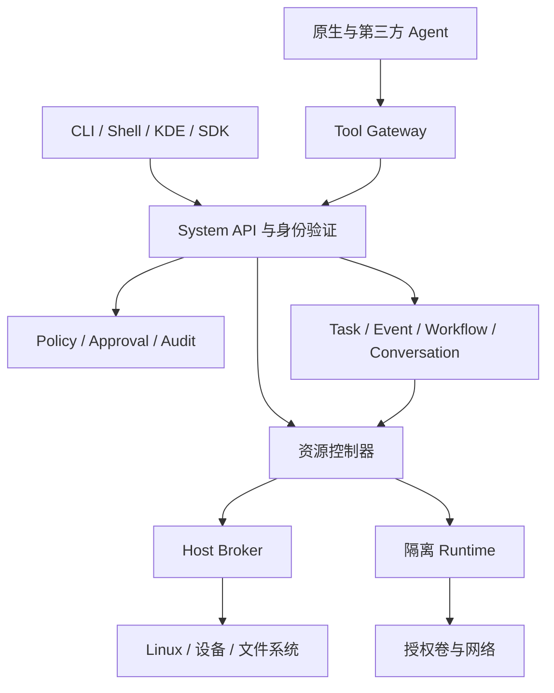

# 01｜产品边界与统一架构

## 1. 产品目标与固定约束

PsiOS 是基于 Linux 的 Agent-Native 操作系统。用户通过 CLI、KDE、WebUI、SDK 和 Agent 访问同一组系统资源；模型离线或 Agent 停止后，传统登录、应用运行、数据访问、诊断和救援仍有独立路径。PsiOS 以独立源码和自身架构为实现基线，由 PsiOS 原生接口、持久化契约和部署规范定义系统行为。

**V1-BASE-001｜三版同源。** Helium 是精简版，Neon 是服务器版，Argon 是 KDE Plasma 桌面版。三者共享资源模型、授权、任务和集群接入契约，差异来自默认安装配置和交互场景，不以硬件档次锁住功能。模型可位于本机、局域网、集群或获准的云端；不要求每个节点装大模型或 Controller。

| 组件/能力 | Helium 默认目标 | Neon 默认目标 | Argon 默认目标 |
|---|---|---|---|
| 最小可信 Host、离线 CLI、诊断、恢复 | 必备 | 必备 | 必备 |
| Identity/Policy、Task/Event、基本卷与 OCI | 同一契约，轻量部署 | 同一契约，服务型部署 | 同一契约，桌面资源调度 |
| 原生 Agent/第三方接入、基础 Chat/DM | 可本机运行；无模型时明确不可推理 | 可长任务运行 | 本机交互入口 |
| 最小 Workflow API/运行器 | 可按需启动 | 可常驻 | 可按需启动 |
| PsiOS Shell | 轻量 WebUI 入口 | Web 管理入口 | 与 KDE 并存 |
| Cluster Worker 接入 | 必备能力、默认未入群 | 必备能力、默认未入群 | 必备能力、资源须显式授权 |
| Cluster Controller、完整 Project、Studio | 可选 | 可选服务器角色 | 可选 |
| KDE/图形会话后端 | 按需安装 | 按需无头会话 | KDE/Wayland 基线 |
| 包导入、GUI Bridge | 可选 Profile | 可选 Profile | 可选 Profile |
| Dataset/Knowledge、TableFS | 可选 | 可选 | 可选 |

“必备能力”描述达到相应里程碑后的发行要求，不等于 M1 原型已经包含所有模块。“可按需启动”表示有本机实现与可用入口，不能只提供一个依赖远端 Controller 的空代理；后台常驻策略必须服从资源预算。基础 Chat 不能依赖可选 Project，基本任务不能依赖 Workflow Studio。

**V1-BASE-002｜容器化边界。** 普通应用、Agent 执行、第三方工具及可选数据服务原则上隔离。内核、驱动、设备管理、启动器、最小授权代理和 Argon 的 KWin 等属于明确的宿主可信计算基；不承诺全部组件都在容器内，也不把 OCI 格式本身当作完整安全隔离。

**V1-BASE-003｜数据边界。** Host Storage → Storage Service → 可选 Data Services 分层。TableFS 是可选 Volume 后端；基础文件 API 不依赖 Dataset。Knowledge 是 Dataset 的授权子集/视图与派生索引；Embedding 是独立服务。主记录保留 `uid/name?/content/tag/score/vector?/extra_data?`；`extra_data` 是通用 JSON，不能收缩为评分器专有对象。

**V1-BASE-004｜协作边界。** Conversation 存交流；WorkItem 存长期目标与验收条件；WorkflowRun 存编排；Task 存执行目标；Run 存尝试；Operation 存系统副作用执行事实。Agent 可主动 @、私聊和有界委托，不能以群成员身份继承发言者权限。外部 PR、CI、合并事实由其供应系统证明。

## 2. 逻辑组件与信任边界

箭头表示经过授权的调用依赖，不表示每个框必须独立进程。可以把轻量服务放入同一进程或数据库，但逻辑权威、权限边界、事务边界和独立救援要求不得消失。跨服务事务只在实际共享事务边界内声明 ACID；不能因框图在同一层就默认原子提交。

**V1-ARCH-001｜启动依赖为有向无环图。** Host 的设备、根卷、日志、最小本机认证和救援先就绪；Core 状态引擎与正常 Policy 之后；OCI 与普通控制器其次；模型、Agent、Chat、Workflow、Project、索引及远端观测再启动。服务管理器必须区分启动必需、运行必需、可选增强。图形或模型失败只影响相应能力，不能让节点反复重启整个系统。

**V1-ARCH-002｜一个字段一个写入权威。** 资源控制器对自己的 `status` 负责，期望状态 `spec` 的权威通过显式转交指定；各域只存其他域的受控引用及带来源修订的缓存投影，不复制第二套可独立修改的事实。源变化通过可靠 outbox/Event 发布，投影失败不能反向覆盖源。

| 域 | 权威对象/字段 | 可以保存的外部引用 | 不得自行认定 |
|---|---|---|---|
| Identity/Policy | Principal、Grant、Delegation、ApprovalDecision、使用账本 | 计划摘要、目标资源版本 | 工具已完成、PR已合并 |
| 资源控制器/Operation | spec、status、Operation 及 EffectRecord | Task/Run、Approval、制品 | 用户已经批准未绑定的新效果 |
| Task Broker | Task、Run、派发/领取、结果引用 | Operation/Artifact | 聊天等于任务完成 |
| Workflow | Definition/WorkflowRun/步骤依赖 | task_id、Operation、ApprovalRequest | 改写 Task 执行结果 |
| Conversation | 成员、Message、提交序号 | Task/WorkItem/附件授权引用 | 群内“同意”产生系统授权 |
| Project | WorkItem、验收条件、项目预算 | Workflow/Task、ExternalLink | Forgejo/CI/发布已成功 |
| 外部系统 | 外部对象及其字段事实 | PsiOS关联标记 | PsiOS内部授权与状态 |
| Storage/Data | Volume、备份清单、Dataset记录、Index水位 | 内容引用、密钥引用 | 索引等于最新主数据或完整撤权 |

## 3. Core、可选服务与精简配置

**V1-ARCH-003｜Core 不是所有服务常驻的集合。** Core 是兼容契约和必备基础实现。离线救援使用最小宿主工具；正常管理使用 Core API；协作、模型与增强数据服务按需启用。Helium 的资源目标通过实际进程、内存、镜像、日志、队列和空闲功耗测量确定，不能凭“轻量”给出无证据的 1 GB 或固定磁盘结论。

预算注册至少含 `profile_id, measurement_environment, core_reserved_memory, core_reserved_disk, queue_limit, audit_limit, max_running_runs, max_agent_calls, max_chat_wakeups, recovery_headroom`。未知数字在候选 Profile 中可以未填；启用自动化或发布 Profile 前须填有限数值并验证超限拒绝。根域预算拒绝不依赖模型判断。

**V1-ARCH-004｜服务失效隔离。** 未装 Data Services 返回 `ServiceNotInstalled`；后端不支持操作返回 `UnsupportedCapability`；已装但依赖故障返回 `DependencyUnavailable`。三者不可混成“成功但空列表”。通过能力发现显示服务版本、支持范围、硬限、实测 Profile 和当前可用状态。

## 4. 实现目录建议

以下是将来源码仓库的建议，与本交付包文档目录不是同一物件：

| 路径 | 责任 |
|---|---|
| `host/` | 引导、救援、Broker、宿主构建 |
| `api/` | Schema、生成代码、错误、工具描述 |
| `identity/` | 主体、授权、审批、Secret、审计入口 |
| `task/`、`event/` | Task/Run、队列、游标、可靠投递 |
| `agent/`、`model/` | 原生运行器、适配器、Skills、模型路由 |
| `conversation/`、`workflow/`、`project/` | 各自权威服务与外部引用 |
| `runtime/`、`packages/` | OCI/Flatpak适配、制品及包环境 |
| `storage/`、`data/` | 卷/备份、TableFS、Dataset/Knowledge |
| `network/`、`device/`、`cluster/` | 网络控制、资源和节点治理 |
| `desktop/`、`shell/` | KDE/Portal、GUI Bridge、统一WebUI |
| `editions/`、`images/` | 三版配置、镜像和安装介质 |
| `tests/`、`docs/` | 契约/故障测试、设计与运维 |

**V1-ARCH-005｜复用需逐模块验收。** 旧归档中出现 `psios-*` crate 名不表示已有 PsiOS v1 实现。先确认仓库、完整提交 SHA、license、依赖、外部地址、授权默认值、数据格式、root 权限和测试条件，再决定 reuse/adapt/rewrite/exclude。Project 文件中的压缩包只是可核验来源，不自动替代最新 Forgejo 审计。

## 5. 长期扩展边界

VM、跨设备同步、弹性/跨架构调度、开发环境、声明式运维、多终端客户端、集中设备策略、AI 费用治理、传统应用兼容和新硬件都保留挂接点。它们必须复用 Workload/Device/Volume/Policy/Operation 契约，先冻结自己的迁移、撤权、数据位置、资源与退出规则。第一轮不自建完整 Kubernetes、分布式文件系统或所有第三方框架兼容层。没有强制完成日期；通过证据门槛推进。
