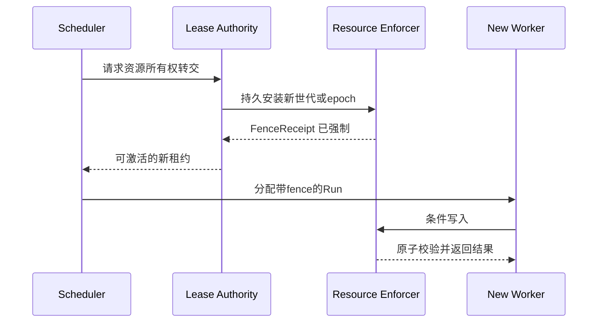

# 12｜集群、租约、资源fencing与节点生命周期

本章承接CLU-001～012、API-013～016和R-01/03/05。M4首个支持目标是单Controller与受控Worker；高可用、多Controller、共享多写和透明迁移各自需要新增实现证据，不能从基础集群接口存在推导已经可用。

## 1. 本地自治与权威

**V1-CLU-001｜加入集群不移交整机。** 三发行版使用同一入群契约，本地启动、登录、恢复和本地工作负载不依赖Controller。管理员明确授权计算、卷、网络、设备与时间窗口；本地政策可以进一步收紧集群政策。Controller仅修改分配给它的资源spec，节点负责实际准入和status。用户文件不会因入群自动复制。

| 对象 | 必要内容 | 权威 |
|---|---|---|
| Cluster | cluster_id、信任域、控制面模式、能力、恢复世代 | Cluster Authority |
| Member | member_id、node_id、身份/凭据版本、成员状态、能力 | Cluster Authority；节点广告是观测 |
| Placement | workload_ref、约束、候选节点、预留及版本 | Scheduler；实际准入由目标节点确认 |
| RunClaim | task/run、领取版本、worker身份、claim_token、有限期限 | Task Broker |
| ResourceLease | resource_id、当前owner、fencing_token、期限、强制后端 | 对应资源租约权威 |
| FenceReceipt | 写入端已持久承认的世代/epoch、实际阻断范围、证据 | 对应资源执行端 |

**V1-CLU-002｜身份引导一次、正式身份可轮换。** 入群先验证真实Cluster信任根和节点身份，再协商支持范围、授予资源。短期bootstrap凭据限用途、使用次数和期限；正式节点身份按资源受众、有效期和撤销管理，禁止通用永久入群密钥。镜像克隆/重装不得直接复用原node_id私钥；密钥丢失、重复身份、时钟不可信和换主板进入明确恢复流程。

## 2. 成员状态不等于资源可写

**V1-CLU-003｜成员状态机。** 正常路径`Joining → Ready → Draining → Left`；`Unreachable`表示无法观测，`Quarantined`表示被隔离。Ready需要身份、兼容、能力及基础健康验证；Unreachable不能推断进程停机。进入Draining后停止新claim，现有工作到安全点或确认fencing后撤销租约。强制退出保留残留工作负载、密钥、卷和外部效果清单。

资源所有权与Member状态分别存储。节点Left后仍可能有未完成外部副作用；重新加入必须核对恢复世代和资源端状态，不凭Ready字符串恢复旧写权限。节点上报的健康/空闲资源不是可信授权证据。

## 3. 领取与写入fencing

**V1-CLU-004｜任务领取不是资源写锁。** 同一Task可有多次Run，但每次领取带持久claim记录及有限期限。Run结果提交检查task_revision、当前run/claim、取消状态、节点身份和恢复世代。迟到结果可记为非权威证据，不能覆盖新Run已确认结果。大结果先持久Artifact再提交引用，控制面日志不直接塞大文件。

**V1-CLU-005｜token具有资源级次序。** 推荐逻辑结构为`{resource_id, recovery_incarnation, epoch}`：incarnation是不透明恢复世代，epoch是同资源同世代内递增十进制字符串。不同resource_id之间不比较epoch；随机incarnation之间不比较大小；每Task自己的run编号不能替代资源全局epoch。

在资源端，fence检查与受保护写入必须属于同一强制边界。写入端拒绝未登记世代或旧epoch。权威发出新epoch但写入端尚未接受它时，旧写者可能仍有访问；新writer只有在资源端持久确认fence/转交后才能启用。无法改造资源端的fd、挂载、DMA或设备写需先隔离/终止旧环境并证明不再可写，否则不得自动迁移。

**V1-CLU-006｜资源端拒旧不等于取消外部动作。** 共享卷fencing不撤销已经提交的PR、支付、邮件或外部设备动作。网络隔离也不能证明远端未接受此前请求。对不可可靠查询的效果使用Unknown，先核实，不以调度新Run自动重做。为了可用性放松fencing需要明确不同能力声明，不能继续声称同一安全保证。

## 4. 断联、重启与时间

| 工作负载性质 | 断联可继续的条件 | 失效动作 |
|---|---|---|
| 本地独立任务 | 本地权威、数据、授权及预算有效 | 按本地政策执行 |
| 离线只读 | 有限、明确的离线Grant，内容与来源可验证 | 到期拒绝新读，持续流按实际能力结束 |
| 共享写 | 所有权、fence、效果前提与许可持续有效 | 无法续证时停写；不自封新owner |
| 需要即时审批 | 当前在线批准与绑定可查 | 暂停/WaitingApproval |
| 外部副作用状态不明 | 已有可靠operation查询/幂等保证才可对账 | Unknown，禁止盲重试 |

**V1-CLU-007｜幂等不替代授权。** 一个重复写是幂等的，也可能因owner改变、资源版本变化或授权撤销而不再合法。离线任务须同时满足全部前提。暂存队列/结果有容量硬限；满时停止接受，重连按源版本、Run和fence对账，不按墙钟“最后写入”胜出。

claim/lease绑定boot_id及本次启动的截止语义；休眠期限规则按03章执行，重启默认失效重新申请。持久化“剩余30秒”后重启再给30秒会延长许可，禁止这种恢复方法。

## 5. 控制面恢复与缓存失效

**V1-CLU-008｜旧快照恢复先隔离后对账。** 暂停新claim，识别仍可能活着的Worker及资源端，按05章恢复安全新鲜度。新incarnation只有被各目标执行端持久认可并拒绝旧世代后才取得该资源写权；不能仅在恢复数据库里把epoch加一。未联系到的资源不激活，对其返回RecoveryRequired。

**V1-CLU-009｜恢复后所有控制订阅失效。** 数据revision、watch游标、成员缓存和调度缓存可能在恢复后倒退或与旧客户端不一致。必须带恢复世代并让旧订阅重新列表；不能把备份中较小的revision当作后续无变化。若选etcd，它自己的revision bump/compaction有缓存失效用途，但不替代PsiOS资源fencing和身份恢复。[etcd灾难恢复](https://etcd.io/docs/v3.6/op-guide/recovery/)

**V1-CLU-010｜单Controller不宣称HA。** Controller停止时已有获准本地服务可按政策继续；需要权威提交的新调度停止。未来多Controller需验证共识、成员变化、仲裁丢失、leader转交和故障域；两个普通投票节点不能容忍任一失联后仍维持多数派。安全目标是在分区中不双写，可用性由明确Profile保证，不用两者模糊互换。

## 6. 放置、数据位置与升级

**V1-CLU-011｜实际准入二次确认。** Placement检查架构/指令集、Runtime、CPU/内存、GPU硬隔离能力、数据位置、网络、授权、优先级和成本。节点接受时预留资源，预留过期/取消释放需绑定原claim，不能释放新owner资源。未授权复制数据或占满用户桌面不能作为调度成功路径。

跨节点连接认证、加密、受网络政策；地址发现不授予权限。NAT下主动连接Worker是传输方式，资源权限不随连接方式改变。Storage Federation先显式远程访问，透明迁移、跨架构进程检查点、多写逐后端验收。

**V1-CLU-012｜升级前排空，能力重协商。** 节点/控制面升级明确允许版本组合、可恢复检查点格式及旧API范围。未知任务格式不领取；不兼容节点可继续本地管理。升级后重新验证设备、驱动、Runtime及fencing能力，不能保留旧能力广告。节点退出/退役还需数据迁移/备份、凭据撤销及未清理清单。

## 7. 最低故障试验

对网络分区、双候选writer、旧worker继续运行、新fence安装中断、controller旧快照、重复/迟到结果、节点克隆、证书轮换、休眠过期、资源预留泄露、滚动升级不兼容分别注入故障。检查不变量必须落到真实资源写入和权威记录，不能只检查调度UI显示一个worker。没有资源端证据的自动迁移标Unsupported，调用返回UnsupportedCapability；所有产品试验当前NotRun。
